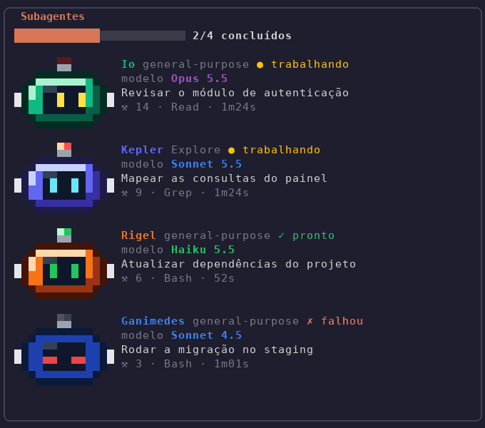
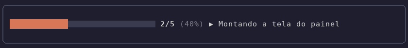
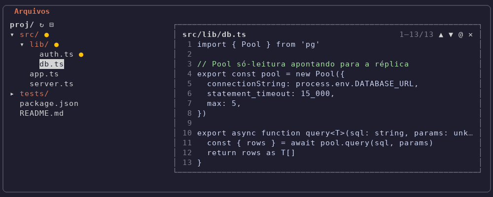

# je-mods

Mods do Claude Code, num plugin só:

- **Progresso das tarefas**: barra acima do prompt com o andamento do `TodoWrite`/`TaskCreate`.
- **Subagentes** (`/agentes`): painel com cada subagente, um robô em pixel art animado com cor e nome astronômico próprios, modelo usado, ferramentas e tempo.
- **Árvore de arquivos** (`/arvore`): painel com a árvore do diretório da sessão; Enter numa pasta abre/fecha, num arquivo insere `@caminho` no prompt; `●` marca o que o agente editou.

## Como fica

Imagens geradas a partir do que os mods desenham de fato (ver [Atualizar as imagens](#atualizar-as-imagens)).

**Subagentes** — trabalhando (antena pisca, olhos varrem), pronto e falhou:



**Progresso das tarefas**, acima do prompt:



**Árvore de arquivos** com o preview de um arquivo aberto:



## Requisito

Os mods são módulos de hook (`hooks/hooks.json` com `modules`), recurso ainda em acesso antecipado no Claude Code. Sem a variável abaixo o plugin instala e valida, mas nenhum mod roda:

```json
// ~/.claude/settings.json
{ "env": { "CLAUDE_CODE_ENABLE_FUNCTION_HOOKS": "1" } }
```

Depois de ligar, abrir uma sessão nova.

## Instalação

Na prompt de uma sessão do Claude Code:

```
/plugin install je-mods --marketplace jos3duardo/je-claude-mods
```

Responder `y` para adicionar o marketplace e escolher o escopo (user, o primeiro, vale para toda sessão). Pelo terminal, o equivalente é:

```bash
claude plugin marketplace add jos3duardo/je-claude-mods
claude plugin install je-mods@je-claude-mods
```

Instalado assim, roda a cópia do commit instalado: para pegar mudança nova, `claude plugin update je-mods@je-claude-mods` e depois `/reload-plugins`.

## Instalação (a partir de um clone local)

```bash
git clone https://github.com/jos3duardo/je-claude-mods.git ~/projetos/je-claude-mods
claude plugin marketplace add ~/projetos/je-claude-mods
claude plugin install je-mods@je-claude-mods
```

O marketplace é a própria pasta: editar aqui e rodar `/reload-plugins` numa sessão aberta já aplica, sem reinstalar.

## Desenvolvimento

```bash
claude plugin validate ~/projetos/je-claude-mods
claude plugin test ~/projetos/je-claude-mods
```

### Atualizar as imagens

Depois de mexer no visual de um mod:

```bash
scripts/preview.sh
```

Ele monta as cenas de `scripts/preview-scenes.tsx` no kit de testes do Claude Code, captura a árvore que cada mod desenha e `scripts/render_preview.py` converte em `docs/*.png` e `docs/agentes.gif`. Precisa de `python3` com Pillow e da fonte DejaVu Sans Mono.
